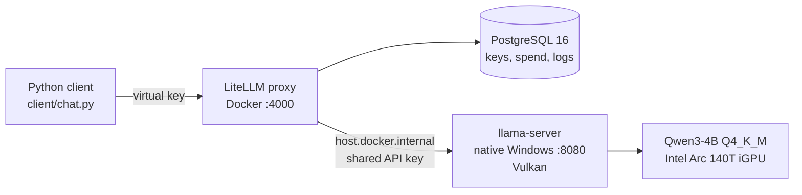

# litellm-lab

A local LLM gateway lab on a Windows 11 laptop: **LiteLLM** as the API gateway (auth, virtual keys, budgets, rate limits, usage tracking) in front of **llama.cpp** running natively on an Intel Arc iGPU.

Built to learn the architecture by measuring it, not by assuming it. Every design decision below was tested against the running stack.



## What it demonstrates

| Area | Implementation |
|---|---|
| **Public model contract** | Clients only see two aliases, `local-fast` (thinking off) and `local-reasoning` (thinking on). Which model sits behind them, how thinking is switched and the sampling settings all live in `config/config.yaml`. |
| **Defence in depth** | llama-server listens on `127.0.0.1` only and requires an API key that only LiteLLM knows, so nothing can bypass the gateway (including browser pages via CORS). |
| **Governance** | Virtual keys per client, with allowed aliases, budgets, rpm/tpm limits and parallel-request caps. A notional price per token makes budgets and spend reports meaningful for a free local model. |
| **Client** | Streams by default, distinct exit codes per failure class (rate limit vs exhausted budget vs auth vs unreachable vs truncated), Ctrl+C cancellation that reaches the GPU, UTF-8 safe when piped. |
| **Safety net** | 25 pytest tests against the live stack (~35 s), LiteLLM pinned by image digest, secrets redacted from test output. |
| **Benchmarks** | `bench/bench.py` measures time-to-first-token, tok/s and contention under identical workloads; raw results in `bench/results.jsonl`. |

## Hardware and measured performance

Intel Core Ultra 7 255H, 31.5 GB RAM, Intel Arc 140T iGPU (shared memory), llama.cpp Vulkan build 12359, Qwen3-4B Q4_K_M:

| Metric | Value |
|---|---|
| Prompt processing (pp512) | ~890 tok/s (GPU) vs ~280 tok/s with 0 GPU layers |
| Generation (tg128) | ~19 tok/s (GPU) vs ~16 tok/s CPU: memory-bandwidth bound |
| Streaming time to first token | ~0.13-0.4 s (vs ~3.4 s waiting for a full answer) |
| Model memory | ~3.9 GB (2.33 GB weights + ~1.15 GB KV cache at 8K context) |

## Repository layout

```
config/config.yaml      LiteLLM model aliases, backend, notional pricing
docker-compose.yml      LiteLLM (pinned by digest) + PostgreSQL
scripts/start-llama.ps1 starts llama-server with the shared key from .env
client/chat.py          CLI client (openai SDK), knows only the aliases
tests/                  pytest suite against the running stack
bench/                  benchmark tool + raw results
models/                 GGUF files (not committed)
```

## Setup (Windows 11, PowerShell)

Prerequisites: Docker Desktop, Python 3.11, Git, and a llama.cpp **Vulkan** build on `PATH` (`llama-server --list-devices` should show your GPU).

### 1. Generate secrets

Copy `.env.example` to `.env` and fill it in. Use **hex-only** values: characters such as `#`, `$`, `/` or `@` break the Postgres connection URL and Docker Compose interpolation.

```powershell
function New-HexSecret { $b = [byte[]]::new(32); [Security.Cryptography.RandomNumberGenerator]::Create().GetBytes($b); ($b | ForEach-Object { $_.ToString('x2') }) -join '' }
New-HexSecret   # run once per secret; prefix sk- for LITELLM_MASTER_KEY and LITELLM_SALT_KEY
```

### 2. Download the model

```powershell
curl.exe -L --fail -# -C - --connect-timeout 20 --retry 5 -o models\Qwen3-4B-Q4_K_M.gguf https://huggingface.co/Qwen/Qwen3-4B-GGUF/resolve/main/Qwen3-4B-Q4_K_M.gguf
```

### 3. Start the stack

```powershell
docker compose up -d                 # LiteLLM + Postgres; first start runs ~225 DB migrations
.\scripts\start-llama.ps1            # separate terminal; refuses to start without LLAMACPP_API_KEY
Invoke-RestMethod http://127.0.0.1:4000/health/readiness   # expect status=healthy, db=connected
```

### 4. Create a client key

Clients never use the master key. Create a virtual key with its own limits and store it in `client/.env` (git-ignored):

```powershell
$mk  = (Get-Content .env | Where-Object { $_ -match '^\s*LITELLM_MASTER_KEY\s*=' }) -replace '^\s*LITELLM_MASTER_KEY\s*=\s*', ''
$req = @{ key_alias = 'python-client-dev'; models = @('local-fast', 'local-reasoning'); max_budget = 0.10; budget_duration = '30d'; rpm_limit = 10; tpm_limit = 5000; max_parallel_requests = 2 } | ConvertTo-Json
$key = (Invoke-RestMethod http://127.0.0.1:4000/key/generate -Method Post -Headers @{ Authorization = "Bearer $mk" } -ContentType 'application/json' -Body $req).key
Set-Content client\.env "LITELLM_API_KEY=$key" -Encoding ascii
Remove-Variable mk, req, key
```

### 5. Use it

```powershell
python -m venv .venv; .\.venv\Scripts\Activate.ps1
python -m pip install -r requirements.txt

python client\chat.py "Explain what an API gateway does, in two sentences."
python client\chat.py "Is 391 a prime number?" --reasoning --show-thinking
python -m pytest -q
```

The LiteLLM admin UI is at http://127.0.0.1:4000/ui (user `admin`, password = master key).

## Client exit codes

| Code | Meaning | Retry helps? |
|---|---|---|
| 0 | Success | |
| 2 | Rate limited (429) after the SDK's retries | Yes, later |
| 3 | Budget exhausted | No, an admin must raise it |
| 4 | Key rejected (401) | No |
| 5 | Gateway unreachable or connection dropped | After fixing infrastructure |
| 6 | Answer truncated at `max_tokens` (tokens were still billed) | With a higher limit |
| 130 | Interrupted with Ctrl+C | |

## Lessons learned (Windows specifics included)

- **URL-safe database passwords.** A `#` in the password made Prisma fail with `P1013 invalid port number`, and a `$` was silently swallowed by Compose interpolation. `POSTGRES_PASSWORD` only applies when the volume is first created; changing it later needs `ALTER ROLE`.
- **Use `127.0.0.1`, not `localhost`, on Windows.** `localhost` tries IPv6 first; Docker publishes IPv4 only, so every connection waited ~2 s (measured: 2043 ms vs 4.7 ms).
- **Thinking mode is expensive on small hardware.** Qwen3-4B found the answer to a simple question within ~450 tokens, then spent the rest of a 2048-token budget second-guessing and never answered. Non-thinking mode answered correctly in 27 tokens.
- **Budgets can be exceeded by one request.** They are checked before a request starts, so `max_tokens` is what bounds the overshoot.
- **Cancellation propagates.** Ctrl+C in the client stopped generation on llama-server within ~64 ms through LiteLLM.
- **Tests must not hide what they test.** Setting `PYTHONIOENCODING` in the test harness masked a crash on default (cp1252) Windows machines; sharing the real client key made the suite hit its own rate limit; pytest printed a key in a failure traceback until fixtures were wrapped in a redacting type.
- **Windows PowerShell 5.1:** `>` writes UTF-16, `Invoke-RestMethod` decodes charset-less responses as Latin-1, and performance counter names are localized (use WMI classes instead of `Get-Counter`).

## Status

Work in progress. Currently evaluating how to serve a larger model (Qwen3-8B) behind `local-reasoning`: two llama-servers, llama.cpp's native router mode (swap vs both resident), or one bigger model for both aliases, each measured with `bench/bench.py`.
